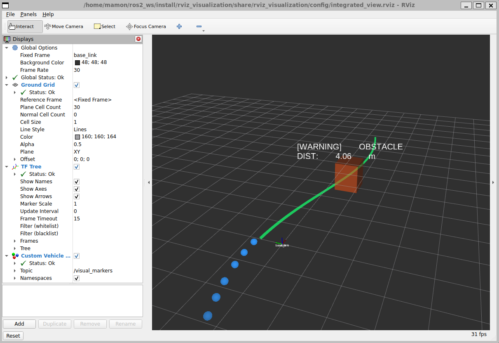
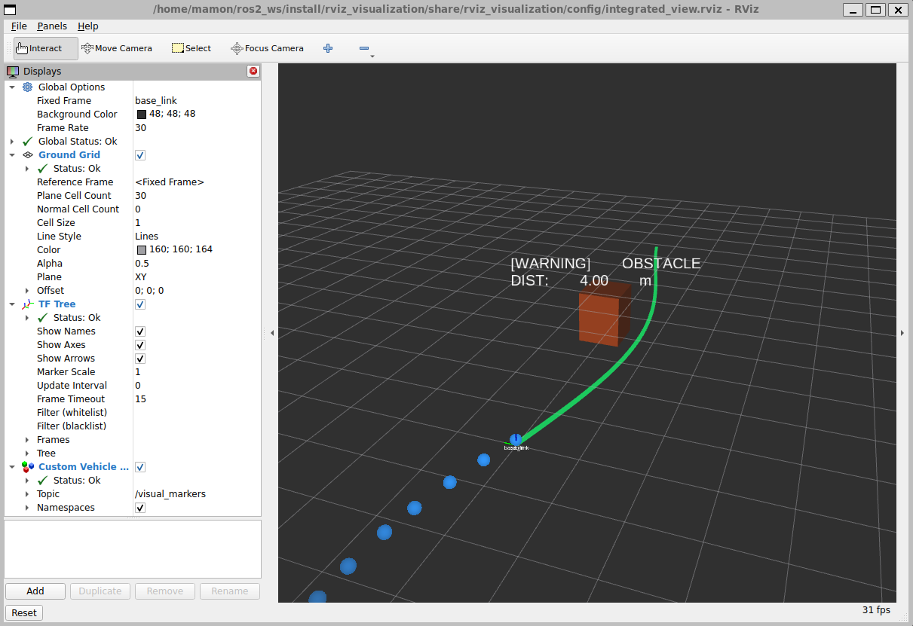
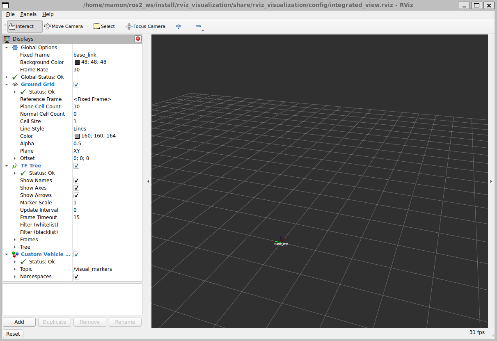

# 9주차 실습 — RViz2 심화 시각화와 커스텀 마커 파이프라인

> 오토모티브SW프로그래밍 · WEEK 09
> `custom_marker_publisher` 노드가 가상 주행 경로(LINE_STRIP), 3D 장애물(CUBE), 경고 텍스트(TEXT_VIEW_FACING), 과거 5초 궤적(SPHERE_LIST, 도전 미션)을 `MarkerArray` 하나로 묶어 `/visual_markers` 토픽에 10Hz로 발행하고, RViz2에서 시각화합니다.

| 항목 | 내용 |
|---|---|
| OS | Windows 11 + WSL2 (Ubuntu 26.04.1 LTS) |
| ROS 2 | Lyrical Luth |
| 패키지 | `rviz_visualization` (ament_python) |
| 토픽 | `/visual_markers` (`visualization_msgs/msg/MarkerArray`, 10Hz) |

---

## 1. 실행화면

### 미션 1 — 경로선 · 장애물 큐브 · 빌보드 텍스트 동시 표시

`ros2 launch rviz_visualization rviz_advanced.launch.py` 실행 직후 RViz2 화면입니다.



- **초록색 S자 곡선 (LINE_STRIP, `ns=trajectory`)**: 전방 10m 예상 주행 경로입니다. 점 40개를 0.25m 간격으로 찍었고 선 두께는 0.08m입니다.
- **주황색 반투명 박스 (CUBE, `ns=obstacles`)**: 전방 4m의 장애물입니다. 크기는 0.8×0.8×1.0m, 알파는 0.6이며 좌우로 천천히 횡단합니다.
- **흰색 텍스트 (TEXT_VIEW_FACING, `ns=warning_labels`)**: 장애물 위 0.8m에 표시되는 `[WARNING] OBSTACLE / DIST: x.xx m`입니다. 카메라가 어느 방향을 보든 정면을 향하는 빌보드 텍스트입니다.
- **파란 점 10개 (SPHERE_LIST, `ns=past_trajectory`)**: 도전 미션 4의 과거 5초 이동 궤적입니다(4절 참고).
- 패널 상태는 `Global Status: Ok`, `TF Tree: Ok`, `Custom Vehicle Markers: Ok`입니다.

약 2초 뒤 같은 화면입니다. 경로선, 장애물, 거리 텍스트, 과거 궤적이 계속 갱신되고 있습니다(10Hz).



### 미션 2 — 노드 강제 종료 후 `lifetime`에 의한 자동 소멸

실행 중인 `custom_marker_publisher` 노드에 **SIGINT(Ctrl+C와 동일)** 를 보내 종료한 뒤의 화면입니다. RViz2는 그대로 켜져 있지만 마커 4종이 모두 사라졌습니다.



```text
[custom_marker_publisher]: 사용자 인터럽트로 마커 노드를 정상 종료합니다.
[INFO] [custom_marker_publisher-2]: process has finished cleanly [pid 515]

# 종료 후 ros2 node list → custom_marker_publisher 가 사라짐
/odom_to_base_link
/rviz
```

**원리**
- 모든 마커에 `lifetime = Duration(sec=0, nanosec=200000000)`, 즉 0.2초를 설정했습니다.
- 노드가 살아 있으면 0.1초(10Hz)마다 같은 `(ns, id)`의 마커가 다시 도착합니다. 그때마다 수명이 리셋되므로 깜빡임 없이 유지됩니다.
- 노드가 죽으면 재수신이 끊기고, RViz2 내부 타이머가 0.2초 만료를 판정해 그래픽 메모리에서 마커를 자동으로 지웁니다.
- `lifetime = 0`(기본값, 무한 수명)이면 노드가 죽어도 마지막 장애물 박스가 화면에 계속 남습니다. 이 잔상(Ghost)은 오판의 원인이 됩니다.

### 미션 3 — `ros2 topic echo /visual_markers --once`

[전체 로그](docs/logs/topic_echo.txt)에서 마커 4개의 핵심 필드만 발췌했습니다.

```yaml
markers:
- header: {frame_id: base_link}
  ns: trajectory        id: 1    type: 4   # LINE_STRIP
  scale: {x: 0.08}
  color: {r: 0.1, g: 0.9, b: 0.4, a: 0.85}
  lifetime: {sec: 0, nanosec: 200000000}
  points: [{x: 0.0, y: 0.68, z: 0.02}, {x: 0.25, y: 0.69, z: 0.02}, ...]   # 40개
- header: {frame_id: base_link}
  ns: obstacles         id: 101  type: 1   # CUBE
  pose: {position: {x: 4.0, y: -0.776, z: 0.5}}
  scale: {x: 0.8, y: 0.8, z: 1.0}
  color: {r: 1.0, g: 0.35, b: 0.1, a: 0.6}
- header: {frame_id: base_link}
  ns: warning_labels    id: 201  type: 9   # TEXT_VIEW_FACING
  pose: {position: {x: 4.0, y: -0.776, z: 1.3}}
  scale: {z: 0.32}
  text: "[WARNING] OBSTACLE\nDIST: 4.07 m"
- header: {frame_id: base_link}
  ns: past_trajectory   id: 301  type: 7   # SPHERE_LIST
  scale: {x: 0.18, y: 0.18, z: 0.18}
  points: 10개 (0.5초 간격, x = -경과시간 × 1.0 m/s)
  colors.a: [0.12, 0.21, 0.32, 0.42, 0.51, 0.60, 0.69, 0.78, 0.89, 0.98]   # 오래된 점일수록 투명
```

```text
$ ros2 topic hz /visual_markers     # 약 6초 측정
average rate: 9.999
	min: 0.099s max: 0.101s std dev: 0.00028s window: 39
```

**분석**
- 서로 다른 타입 4개(4, 1, 9, 7)의 마커가 **하나의 MarkerArray 메시지**에 담겨 한 번에 발행됩니다.
- 그래서 DDS 패킷과 수신 콜백이 4번이 아니라 1번만 발생하고, 모든 마커가 같은 타임스탬프로 같은 프레임에 그려집니다(원자성).
- 각 마커의 고유 키는 `(ns, id)` 조합입니다. 같은 키로 다시 발행하면 기존 마커를 덮어씁니다(ADD/MODIFY).

### 미션 4 (도전) — 과거 5초 궤적 그라데이션

- 0.5초마다 차량의 횡방향 위치를 버퍼에 기록하고, 5초보다 오래된 기록은 버퍼에서 지웁니다. 그래서 점은 최대 10개입니다.
- Fixed Frame이 `base_link`(차량 고정)이므로 과거 위치는 차량 뒤쪽 `x = -(경과 시간 × 1.0 m/s)`에 그립니다.
- `SPHERE_LIST`의 `colors[]`에 점마다 알파를 따로 지정합니다. `a = 0.1 + 0.9 × (1 - age/5.0)`이므로 최근 점(진한 파랑)에서 5초 전 점(거의 투명)으로 갈수록 옅어집니다. 위 실행화면 아래쪽의 파란 점들이 이 궤적입니다.

---

## 2. 패키지 구조

```text
week09-rviz/
├── rviz_visualization/                 # ROS 2 패키지 (ament_python)
│   ├── package.xml
│   ├── setup.py / setup.cfg
│   ├── resource/rviz_visualization
│   ├── rviz_visualization/
│   │   └── custom_marker_publisher.py  # 마커 발행 노드
│   ├── launch/
│   │   └── rviz_advanced.launch.py     # 정적 TF + 마커 노드 + RViz2 통합 기동
│   └── config/
│       └── integrated_view.rviz        # RViz2 설정 (Grid, TF, MarkerArray)
├── scripts/
│   ├── run_week09.sh                   # 빌드 → 실행 → 캡처 → 로그 자동화
│   └── capture_window.ps1              # RViz2 창 캡처 (Windows)
└── docs/
    ├── images/                         # 실행화면
    └── logs/                           # build / launch / topic echo / hz 로그
```

## 3. 빌드 및 실행

```bash
# 1) 워크스페이스로 복사 후 빌드
mkdir -p ~/ros2_ws/src
cp -r rviz_visualization ~/ros2_ws/src/
cd ~/ros2_ws
source /opt/ros/lyrical/setup.bash
colcon build --symlink-install --packages-select rviz_visualization
source install/setup.bash

# 2) 통합 실행 (마커 노드 + RViz2)
#    WSLg + Ubuntu 26.04에서는 Qt가 Wayland로 뜨면 RViz2 렌더 창 생성이 실패하므로 X11 강제
export QT_QPA_PLATFORM=xcb
ros2 launch rviz_visualization rviz_advanced.launch.py

# 3) 다른 터미널에서 패킷 확인
ros2 topic echo /visual_markers --once
ros2 topic hz /visual_markers
```

런치 인자를 바꿔서 실행할 수도 있습니다.

```bash
ros2 launch rviz_visualization rviz_advanced.launch.py obstacle_distance:=3.0 publish_rate:=20.0
```

## 4. 제공 코드에서 보완·수정한 부분

| 구분 | 내용 | 이유 |
|---|---|---|
| 빌드 파일 추가 | `package.xml`, `setup.py`, `setup.cfg`, `resource/` | 제공 코드에 없어서 `colcon build`가 불가능했음. launch와 config를 `share/`에 함께 설치하도록 함 |
| launch 실행 파일명 | `custom_marker_publisher.py` → `custom_marker_publisher` | ament_python의 `console_scripts` 이름과 맞춤 |
| 정적 TF 추가 | `odom → base_link` `static_transform_publisher` | TF 트리에 `base_link`가 없으면 RViz2 Global Status가 Warn이 됨 |
| 경고 텍스트 영문화 | `[위험] 장애물 감지!` → `[WARNING] OBSTACLE` | RViz2 기본 폰트에 한글 글리프가 없어 □로 깨짐 |
| 종료 처리 | `SignalHandlerOptions.NO` + `KeyboardInterrupt` 처리, `rclpy.try_shutdown()` | Lyrical rclpy에서 Ctrl+C 시 `RCLError: context is not valid`가 나며 비정상 종료되던 문제 수정 |
| 도전 미션 4 | `past_trajectory` SPHERE_LIST 마커 추가 | 과거 5초 궤적 그라데이션 |

## 5. 트러블슈팅 기록

1. **RViz2 창이 뜨지 않음**
   - 증상: `RenderingAPIException: Invalid parentWindowHandle (wrong server or screen)`
   - 원인: Ubuntu 26.04 + WSLg에서 Qt가 Wayland 플랫폼으로 실행되어 OGRE(GLX)가 렌더 창을 만들지 못함
   - 해결: `export QT_QPA_PLATFORM=xcb`로 X11(XWayland)을 사용하도록 함
2. **노드 종료 시 `RCLError`**
   - 원인: rclpy 기본 SIGINT 핸들러가 컨텍스트를 먼저 shutdown해서 `spin()` 내부의 wait set 생성이 실패함
   - 해결: rclpy 시그널 핸들러를 끄고 Python 기본 `KeyboardInterrupt`로 받아 `destroy_node()` → `try_shutdown()` 순서로 직접 정리함. 그 결과 `process has finished cleanly`로 정상 종료됨

## 6. 로그

- [build_log.txt](docs/logs/build_log.txt)
- [launch_log.txt](docs/logs/launch_log.txt)
- [topic_echo.txt](docs/logs/topic_echo.txt)
- [topic_hz.txt](docs/logs/topic_hz.txt)
- [topic_info.txt](docs/logs/topic_info.txt)
- [node_list.txt](docs/logs/node_list.txt) / [node_list_after_kill.txt](docs/logs/node_list_after_kill.txt)
